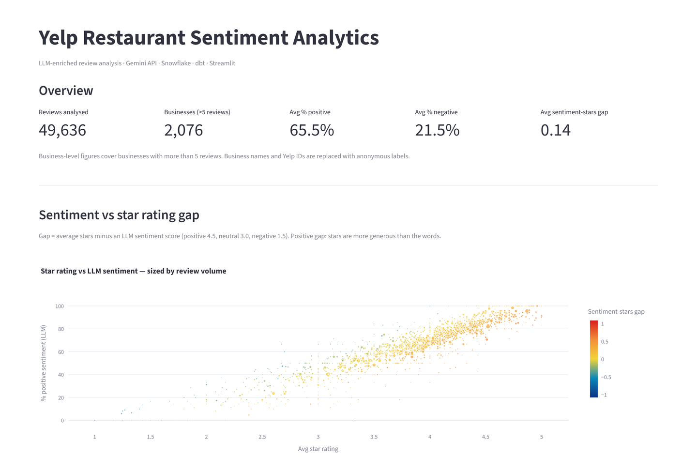
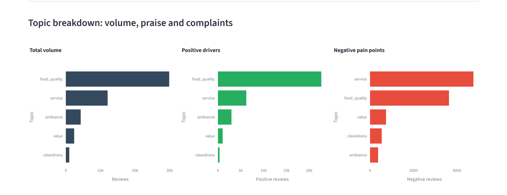
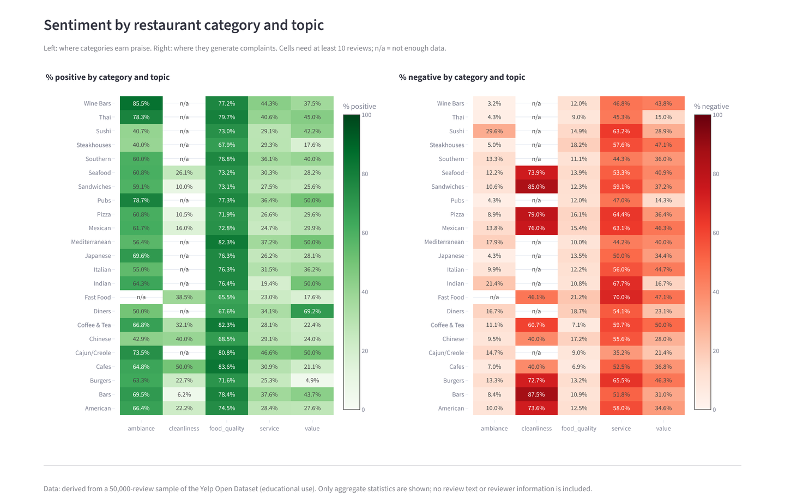

# LLM-Enriched Restaurant Sentiment Analytics

**Turning 50,000 free-text Yelp reviews into structured, queryable signals with the Gemini API, then modeling them in Snowflake + dbt and exploring them in a Streamlit dashboard.**

**Live demo:** _<add Streamlit Cloud URL>_



---

## What it does and why

A star rating tells you *how much* a customer liked a restaurant, but not *why*. This project uses an LLM to read each review and pull out structured fields:

| Field | Values |
|---|---|
| `sentiment` | positive / neutral / negative |
| `primary_topic` | food_quality / service / ambiance / value / cleanliness |
| `secondary_topics` | up to 2 more topics from the same list |
| `intensity` | 1–5, how strongly the opinion is expressed |
| `is_local_regular` | whether the reviewer appears to be a repeat local customer |

With those fields you can ask questions that star ratings alone can't answer:

- **What are people complaining about?** In this sample, food quality is the most-discussed topic (about 60% of reviews) but is mostly praised (76% positive). **Service** produces the largest number of negative reviews (39% of service reviews are negative). **Cleanliness** is rarely the main topic (about 2% of reviews), but when it is, 54% of those reviews are negative.
- **Where do words and stars disagree?** Each business gets a *sentiment-stars gap*: average stars minus an LLM-based sentiment score (positive = 4.5, neutral = 3.0, negative = 1.5). Overall, LLM sentiment tracks stars closely (correlation 0.92 between % positive and average stars). Even so, 172 of 2,076 businesses have a gap of 0.5 or more, meaning their ratings are noticeably more generous than their written reviews.
- **Which category × topic combinations are pain points?** For example, which cuisines get cleanliness or service complaints (see heatmaps below).
- **Does a loyal local base mean better sentiment?** Not in this sample: the share of LLM-detected "local regulars" shows essentially no correlation with % positive (r ≈ 0.05).

> These are observations from one 50k-review set. The LLM labels were spot-checked by hand on a small first batch before the full run, but no formal accuracy metric was computed. Treat the findings as exploratory, not statistically tested.

## Architecture

```
Yelp Open Dataset (JSON, downloaded locally — not in this repo)
        │  pipeline/ingestion/load_raw.py   (first 50,000 rows of each file — not a random sample)
        ▼
Snowflake  RAW.RAW_BUSINESSES, RAW.RAW_REVIEWS
        │  pipeline/enrichment/*            (Gemini 2.5 Flash-Lite, JSON output mode)
        │  pipeline/load/upload_to_snowflake.py
        ▼
Snowflake  RAW.RAW_REVIEWS_ENRICHED
        │  dbt (dbt_project/)
        ▼
  bronze  stg_reviews                    raw reviews joined to LLM fields
  silver  int_reviews_clean              type casting, null handling, quality_status flag
  gold    business_sentiment_summary     per-business sentiment, intensity, local-regular %, gap
          topic_performance_by_category  per category × topic stats
        │  export → dashboard/build_demo_data.py (anonymized aggregates)
        ▼
Streamlit dashboard (dashboard/app.py)  ← reads only data/demo/*.csv
```

### LLM enrichment

The prompt asks Gemini 2.5 Flash-Lite (temperature 0.1, `application/json` response mode) to return only a JSON object, with two few-shot examples. Reviews are truncated to 400 characters to keep token usage down. The enrichment step went through three versions, all kept in `pipeline/enrichment/`:

1. **`enrich_reviews.py`**: a simple synchronous loop sized for the Gemini free tier. It sleeps about 4 seconds between calls to stay under 15 requests/minute and writes results to Snowflake every 25 rows. At that pace (about 900 reviews per hour), 50k reviews would take more than two days.
2. **`prepare_batch.py` → `submit_job.py` → `check_jobs.py`**: writes every un-enriched review as a request line in a JSONL file and submits it to the **Gemini Batch API**, which processes large jobs asynchronously at lower cost.
3. **`async_enrichment.py`**: processes the same JSONL request file client-side with `asyncio`. It caps concurrency with a semaphore (20 in flight), uses a sliding-window rate limiter (500 RPM), and retries 429 / `RESOURCE_EXHAUSTED` errors with exponential backoff. It appends results to `enriched_reviews.jsonl` and records finished IDs in a checkpoint file, so an interrupted run resumes where it left off. Rows that fail JSON parsing are tagged `bad_json` instead of crashing the run. **This version produced the data that was loaded** (`upload_to_snowflake.py` keeps only rows with `status == "ok"`).

### dbt models and tests

Models live in `dbt_project/models/{bronze,silver,gold}` (bronze/silver/gold are organizational layers; models use dbt's default materialization). Every model and source column is documented in `schema.yml` / `src_raw.yml`, which defines 10 tests:

- `unique` + `not_null` on `int_reviews_clean.review_id` and `business_sentiment_summary.business_id`
- `not_null` on `stars` and `intensity`
- `accepted_values` on the LLM-generated `sentiment` (`positive`/`neutral`/`negative`) and on the derived `quality_status`
- `accepted_values` on the LLM-generated `primary_topic` (the five allowed topics) and `intensity` (1–5), applied to `clean` rows

The original 8 tests passed in the last Snowflake run. The `primary_topic` and `intensity` tests were added while preparing this repo. The project parses cleanly with dbt 1.11, and all 49,636 exported clean rows satisfy both rules, but these two tests have not been re-run in Snowflake.

The silver model flags records whose LLM output is incomplete or whose rating is out of range, rather than silently dropping them. Gold models use only `clean` rows.

## Dashboard

| | |
|---|---|
|  |  |

Sections: headline KPIs · sentiment vs star rating gap (scatter) · topic volume / positive drivers / negative pain points · local-regular share vs sentiment · largest-gap table · sentiment composition by topic · intensity distribution by sentiment · % positive and % negative heatmaps by cuisine category × topic.

## Tech stack

Python (asyncio, pandas) · Google Gemini API (`google-genai`, Batch API) · Snowflake (`snowflake-connector-python`, `write_pandas`) · dbt-core + dbt-snowflake · Streamlit · Plotly

## Run the dashboard locally

Requires Python 3.10+.

```bash
git clone https://github.com/<your-username>/yelp-sentiment-portfolio.git
cd yelp-sentiment-portfolio
python -m venv .venv
# Windows: .venv\Scripts\activate    macOS/Linux: source .venv/bin/activate
pip install -r requirements.txt
streamlit run dashboard/app.py
```

The dashboard needs no API keys or database. It reads the small aggregate files in `data/demo/`.

## Re-running the full pipeline (optional)

You need your own Yelp Open Dataset download, a Gemini API key and a Snowflake account.

1. `pip install -r pipeline/requirements.txt`
2. Copy `.env.example` to `.env` and fill in your values. Copy `dbt_project/profiles.yml.example` to `~/.dbt/profiles.yml`.
3. `python pipeline/ingestion/load_raw.py`
4. `python pipeline/enrichment/prepare_batch.py`, then either `submit_job.py` (Batch API) or `async_enrichment.py`
5. `python pipeline/load/upload_to_snowflake.py`
6. `cd dbt_project && dbt run && dbt test`
7. Export `ANALYTICS.INT_REVIEWS_CLEAN`, `ANALYTICS.BUSINESS_SENTIMENT_SUMMARY` and `RAW.RAW_BUSINESSES` to CSV, then run
   `python dashboard/build_demo_data.py --reviews ... --summary ... --businesses ...`

## Data note

This project uses the [Yelp Open Dataset](https://business.yelp.com/data/resources/open-dataset/), which Yelp provides for educational use under its own dataset agreement. **No Yelp data is redistributed here:** no review text, reviewer IDs or names, business names or addresses, and no Yelp business IDs. `data/demo/` contains only aggregate statistics (counts, averages and percentages), with businesses replaced by anonymous labels such as "Business 0001". To reproduce the pipeline, download the dataset from Yelp yourself.

## Limitations and next steps

- **Limited validation of LLM labels.** Sentiment, topic, intensity and the local-regular flag come from a single LLM pass. Labels were spot-checked by hand on an initial batch before scaling up; a natural next step is a formal hand-labeled sample with a measured agreement rate.
- **Single primary topic** per review, from a fixed list of five. `secondary_topics` are extracted but not yet used in the gold layer or the dashboard.
- **Not a random sample:** `load_raw.py` takes the first 50,000 rows of the review file and the first 50,000 rows of the business file, and only reviews whose business is in that set were enriched. Results may not generalize to the full dataset.
- **Gap metric is heuristic:** the mapping positive=4.5 / neutral=3.0 / negative=1.5 is a simple choice, not a calibrated model.
- The dashboard's category × topic view is computed in the export script rather than in a dbt gold model. Moving it into dbt would keep all business logic in one place.
- Possible additions: AI-generated narrative summaries of gold-layer aggregates, time trends using review dates, and an incremental dbt model for new reviews.

## About

Built with the help of AI coding assistants (Google Gemini and Anthropic Claude).
